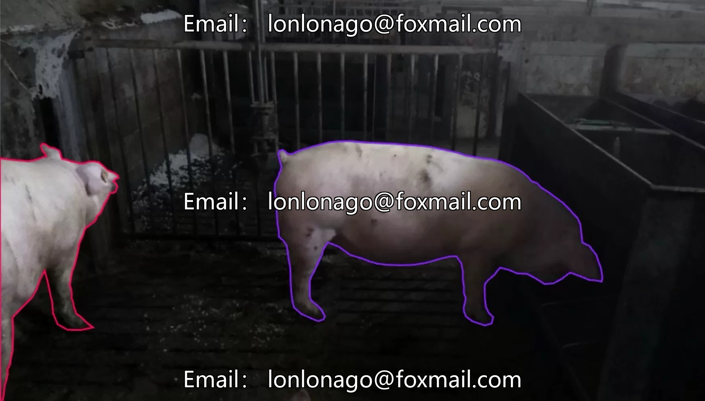
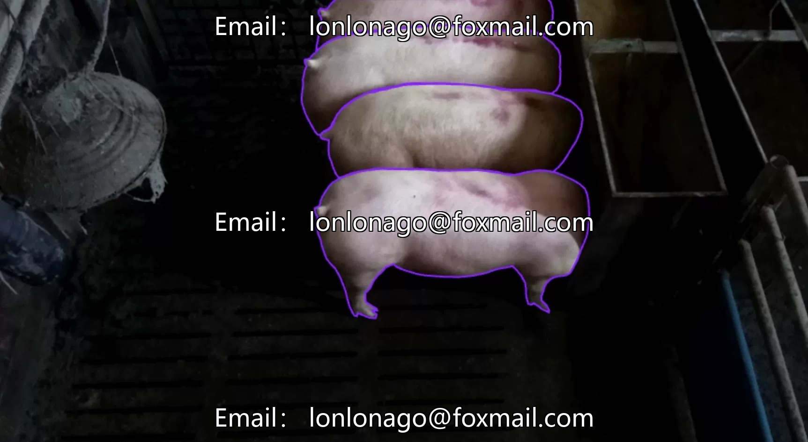
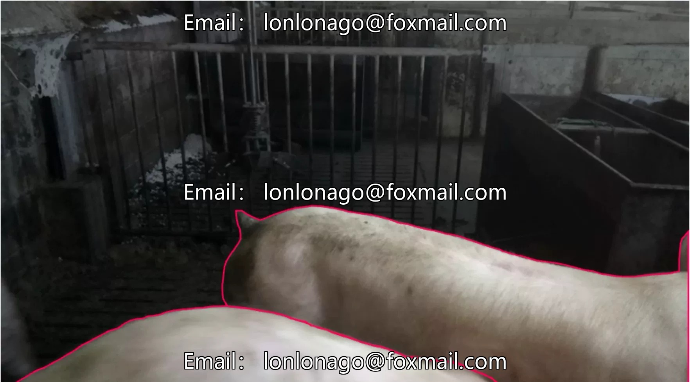
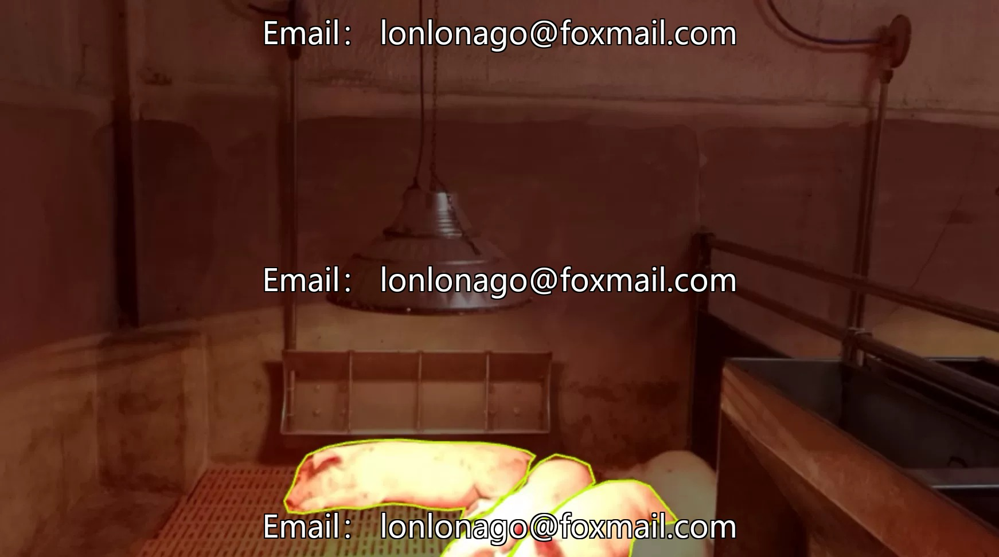
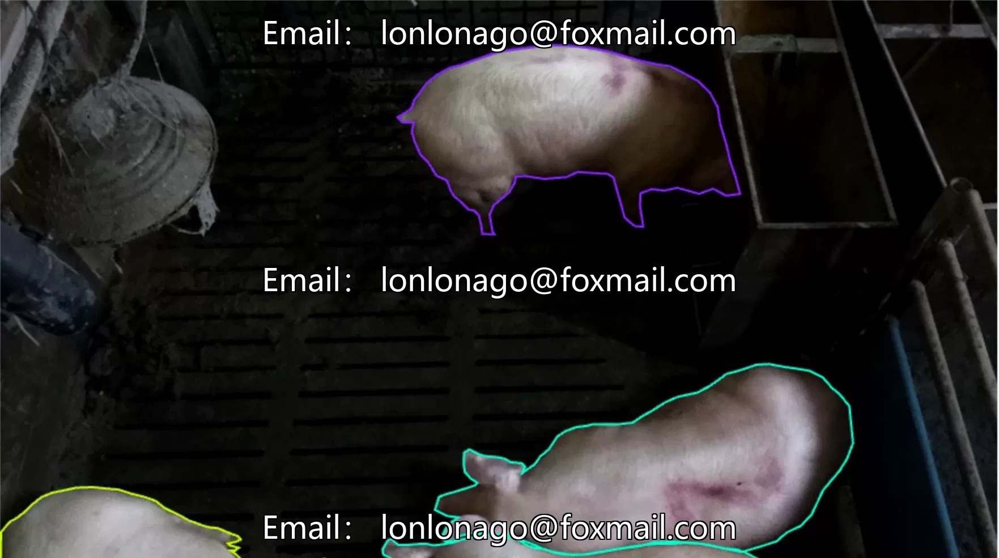

# Pig behavior instance segmentation dataset, containing 454 images, 4 core categories: eating

## Body

Pig behavior instance segmentation dataset, containing 454 images, with 4 core categories: Eating, Lying, Sitting, Standing. The dataset focuses on the four typical behavioral states of pigs, suitable for training and testing computer vision models, supports behavior monitoring and analysis in breeding scenarios, and enhances intelligent management of breeding.

The data format is an image file, accompanied by one dataset, which can be directly used for model training and testing. The data is targeted, the quantity is moderate, suitable for basic model development and preliminary application testing.

Virtual materials, once sold, are non-refundable.
Interested friends, click "I want" to proceed.

## Images

## Payment

Here is a pay link on Stripe ( https://buy.stripe.com/3cs8yP7sY87d0vu9AB ). Please contact me lonlonago@foxmail.com after funding $89, and I will send you a complete data files , thank you!

